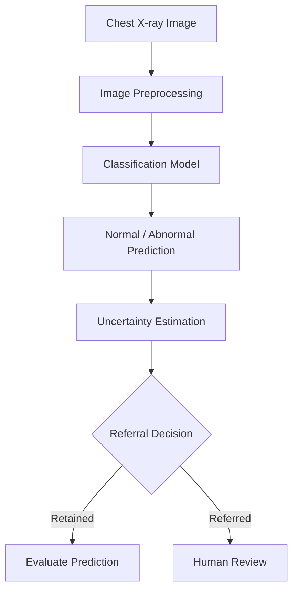

# Chest X-ray Classification & Reliability Assessment

### Building More Reliable AI for Medical Imaging

  
  
  

## Overview

Chest X-ray imaging plays an important role in medical practice, and machine learning offers promising opportunities to support the analysis of radiographic examinations. However, classification accuracy alone is not enough to establish whether an AI model is reliable or whether its uncertain predictions can be identified for further review.

**Chest X-ray Classification & Reliability Assessment** is a medical imaging machine learning project focused on binary chest X-ray classification and the systematic evaluation of model reliability.

Using the NIH ChestX-ray14 dataset, the project aims to build a reproducible classification pipeline, compare multiple machine learning and deep learning approaches, and investigate probability calibration, predictive uncertainty, and selective referral for human review.

The project is organized into two main milestones: establishing a rigorous data and baseline foundation, followed by comprehensive model comparison and reliability evaluation.

> **Core objective:** Understand not only how accurately a model classifies chest X-rays, but also how reliable its predictions are and when uncertain cases should be referred for further review.

## How the System Works

The intended system workflow takes a chest X-ray image, generates a classification prediction, estimates the uncertainty associated with that prediction, and determines whether the prediction should be retained for evaluation or the case referred for human review.

The referral decision will be investigated experimentally using predefined uncertainty criteria. It does not guarantee clinical safety or replace professional medical judgment.

## Project Objectives

- Develop a reproducible chest X-ray classification pipeline.
- Distinguish Normal from Abnormal frontal chest X-ray examinations.
- Prevent patient-level data leakage between training, validation, and test sets.
- Establish meaningful baseline performance before training more complex models.
- Compare machine learning and deep learning classification approaches.
- Evaluate classification performance using appropriate metrics.
- Investigate probability calibration and predictive uncertainty.
- Assess selective referral as a strategy for handling uncertain predictions.
- Analyze performance and referral behavior across available patient and image subgroups.
- Document limitations and support transparent, reproducible experimentation.

## Dataset

### NIH ChestX-ray14

The project uses the NIH ChestX-ray14 dataset and its associated metadata.

- **Official dataset source:** [NIH ChestX-ray14](https://nihcc.app.box.com/v/ChestXray-NIHCC)
- **Reference paper:** Wang et al., *ChestX-ray8: Hospital-scale Chest X-ray Database and Benchmarks on Weakly-Supervised Classification and Localization of Common Thorax Diseases*, CVPR 2017.
- **Unit of analysis:** Patient-level examinations.

The dataset will be obtained through the official NIH distribution source, subject to its access and usage conditions.

### Classification Task

The project focuses on binary classification of frontal chest X-ray images.

| Class | Definition |
|---|---|
| Normal | An image labeled `No Finding`. |
| Abnormal | An image with at least one reported thoracic finding. |

The labels were automatically extracted from radiology reports and may contain noise. They must not be treated as perfect, independently confirmed clinical ground truth.

A reproducible subset may be used if computational constraints make full-dataset training impractical. Any sampling strategy will be documented and must preserve patient independence and class representation.

---

# Milestone 1 — Dataset & Preprocessing

**Objective:** Understand the dataset, establish a reliable preprocessing pipeline, prevent data leakage, and develop reproducible baseline results.

Milestone 1 establishes the foundation required for the more extensive modeling and reliability experiments in Milestone 2.

### 1. Data Card

Document the dataset's characteristics and limitations, including:

- Official source and access date.
- Dataset size, image format, and metadata fields.
- Definitions of Normal and Abnormal.
- Handling of cases with multiple reported findings.
- Dataset limitations, including label noise, class imbalance, repeated examinations, and acquisition-view differences.
- Ethical considerations, responsible use, and the limitations of an experimental medical AI system.

### 2. Data Audit & Exploratory Data Analysis

Perform a systematic audit before model development.

Planned analyses include:

- Counting patients, images, classes, and images per patient.
- Inspecting representative Normal and Abnormal images.
- Analyzing image resolution, aspect ratio, intensity, brightness, contrast, and blur.
- Detecting exact and near-duplicate images.
- Investigating repeated examinations from the same patient.
- Examining class imbalance and available age, sex, and AP/PA view distributions.
- Comparing image-quality characteristics across classes and subgroups.
- Exploring pretrained image embeddings using PCA and UMAP or t-SNE.

The analysis will conclude with evidence-based findings that inform preprocessing, splitting, model selection, and evaluation decisions.

### 3. Cleaning & Preprocessing

Develop a documented and reproducible data preparation pipeline.

- Identify unreadable or invalid images.
- Record exclusions and their justifications in a cleaning log.
- Resize images to a fixed input resolution.
- Define and document intensity normalization.
- Apply clinically plausible data augmentation to training data only.
- Fit data-dependent preprocessing operations using training data only.
- Record preprocessing configurations and random seeds.

### 4. Patient-Wise Data Splitting

Create training, validation, and test sets at the patient level.

**Images from the same patient must never appear across different data splits.**

The pipeline will save the patient and image indices associated with each split and include checks for patient overlap.

The test set will remain untouched during model development and model selection until final evaluation.

### 5. Baseline Development

Establish reference results before introducing more complex classification models.

The baseline stage includes:

- A dummy classifier.
- Logistic regression using pretrained image embeddings.
- A learning curve based on increasing fractions of training patients.
- Selection of primary and secondary metrics informed by the data audit.

### Milestone 1 Deliverables

The expected outputs include:

- A documented data card.
- An exploratory data analysis notebook.
- A cleaning log.
- A reproducible preprocessing pipeline.
- Saved patient-wise train, validation, and test indices.
- Checks demonstrating the absence of patient overlap between splits.
- Baseline results and a learning curve.
- A report documenting the methodology, findings, limitations, and Phase Two plan.

**Milestone 1 completion criterion:** A reproducible data pipeline and baseline that provide a reliable foundation for the model comparison and evaluation work in Milestone 2.

---

# Milestone 2 — Modeling & Evaluation

**Objective:** Compare the required classification models and evaluate their performance, calibration, uncertainty, and selective-referral behavior.

Milestone 2 builds on the dataset preparation and baseline established in Milestone 1.

### 1. Model Comparison

Five candidate approaches will be evaluated.

| Model | Purpose |
|---|---|
| Logistic Regression on pretrained embeddings | Establish a simple, interpretable baseline. |
| Support Vector Machine (SVM) on pretrained embeddings | Evaluate a margin-based classifier using the same image representation. |
| ResNet with transfer learning | Evaluate a standard convolutional neural network. |
| DenseNet with transfer learning | Evaluate an architecture widely used in chest X-ray modeling. |
| EfficientNet or a small Vision Transformer | Evaluate an efficient CNN or transformer-based alternative. |

The models will be compared using consistent data splits, documented preprocessing, appropriate metrics, and reproducible experiment configurations.

### 2. Classification Performance

Evaluate classification performance using:

- Area Under the Receiver Operating Characteristic Curve (AUROC).
- Area Under the Precision-Recall Curve (AUPRC).
- Sensitivity (Recall).
- Specificity.
- Precision.
- F1-score.
- Confusion matrix.

Accuracy alone will not be considered sufficient, particularly in the presence of class imbalance.

False positives and false negatives will be analyzed separately because they represent different error types and have different potential implications in medical imaging.

### 3. Probability Calibration

Investigate whether the probabilities predicted by the models correspond to observed outcomes.

Planned methods include:

- Reliability diagrams.
- Brier score.
- Expected Calibration Error (ECE).
- Temperature scaling.
- Comparison of calibration before and after temperature scaling.

Calibration procedures will use appropriate validation data, with the test set reserved for final assessment.

### 4. Predictive Uncertainty

Investigate whether uncertainty estimates can help identify predictions that are more likely to be incorrect.

The project will consider predictive entropy or Monte Carlo dropout, depending on the selected model and implementation.

The analysis will document how uncertainty is calculated and examine its relationship with classification errors.

Uncertainty will be interpreted as a model-derived signal, not proof that an examination is medically difficult or that a prediction is necessarily incorrect.

### 5. Selective Referral

Evaluate a strategy in which uncertain predictions are referred for human review while other predictions are retained for evaluation.

Planned analyses include:

- Risk-coverage curves.
- Performance at referral rates of 10%, 20%, and 30%.
- Comparison of error rates among retained and referred cases.
- Analysis of the trade-off between automated coverage and classification risk.

The objective is to determine whether selective referral improves performance on retained cases and to identify situations where it may fail.

### 6. Subgroup Analysis

Analyze model performance and reliability across available subgroups, including:

- AP versus PA acquisition views.
- Age groups.
- Sex.
- Image-quality groups.

The analysis will compare classification errors, calibration, and referral rates to identify potential performance differences and limitations.

### 7. Statistical Reporting

Strengthen the reliability of the reported results using confidence intervals or repeated-seed experiments for the main performance measures, where computationally feasible.

Results will be documented in tables and figures, with comparisons interpreted in the context of the dataset, evaluation methodology, and known limitations.

### Milestone 2 Deliverables

The expected outputs include:

- A documented comparison of the five candidate models.
- Classification metrics and confusion matrices.
- Calibration diagrams and associated metrics.
- Predictive uncertainty analysis.
- Risk-coverage curves and selective-referral results.
- Subgroup performance and reliability analysis.
- Statistical estimates for the main evaluation metrics.
- A reproducible record of experiment configurations and results.
- A report explaining findings, limitations, and responsible interpretation.

**Milestone 2 completion criterion:** A reproducible and documented evaluation of classification performance and reliability, including calibration, uncertainty, selective referral, and subgroup analysis.

---

## Reproducibility & Responsible Use

Reproducibility is a core requirement throughout both milestones.

The project will document:

- Dataset source and access information.
- Software and package versions.
- Random seeds and preprocessing configurations.
- Patient-wise split files.
- Model configurations and experiment settings.
- Checkpoints and evaluation outputs where appropriate.
- Instructions for reproducing the reported analyses and results.

The original dataset and other restricted or sensitive artifacts will not be committed to the public repository. Dataset access and usage conditions must be respected.

### Medical Disclaimer

This project is an educational and experimental medical imaging research prototype. It is not intended for clinical diagnosis, does not replace qualified medical professionals, and has not been established as clinically validated.

Dataset label noise, demographic imbalance, acquisition differences, and limited generalization may affect the reported results. Calibration, uncertainty estimation, and selective referral do not guarantee clinical safety.

All conclusions will be restricted to what the experiments and available data support.

## Development Workflow

The project uses a simple Git branching strategy to organize implementation and evaluation.

| Branch | Responsibility |
|---|---|
| `main` | Stable, reviewed project version. |
| `develop` | Integration branch for completed work. |
| `feature/data-pipeline` | Data auditing, preprocessing, and patient-wise splitting. |
| `feature/model-training` | Baselines, model training, and model comparison. |
| `feature/model-evaluation` | Classification metrics, calibration, uncertainty, and selective-referral analysis. |

Feature work will be integrated into `develop` after review. Stable, reviewed versions will be promoted to `main`.

## References

1. Wang, X., Peng, Y., Lu, L., Lu, Z., Bagheri, M., and Summers, R. M. “ChestX-ray8: Hospital-scale Chest X-ray Database and Benchmarks on Weakly-Supervised Classification and Localization of Common Thorax Diseases.” *Proceedings of the IEEE Conference on Computer Vision and Pattern Recognition (CVPR)*, 2017.
2. NIH Clinical Center. [NIH ChestX-ray14 Official Dataset Access](https://nihcc.app.box.com/v/ChestXray-NIHCC).

## Current Project Status

**Current phase:** Repository setup and Milestone 1 preparation.

The immediate priorities are to audit the dataset, implement preprocessing and patient-wise splitting, document the findings, and establish reproducible baseline results before moving to the comprehensive model comparison and reliability evaluation in Milestone 2.

---

  <strong>Reliable predictions require more than high accuracy.</strong>
   
  Understanding uncertainty, calibration, and failure cases is essential to evaluating medical imaging AI responsibly.

